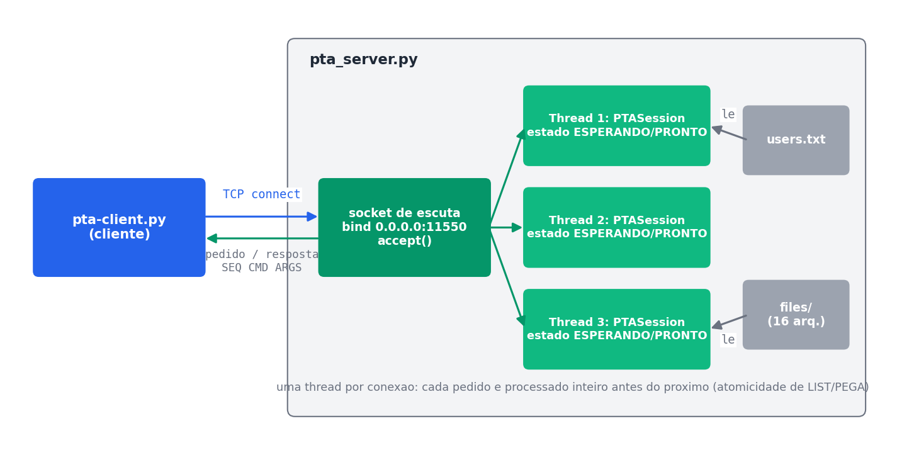
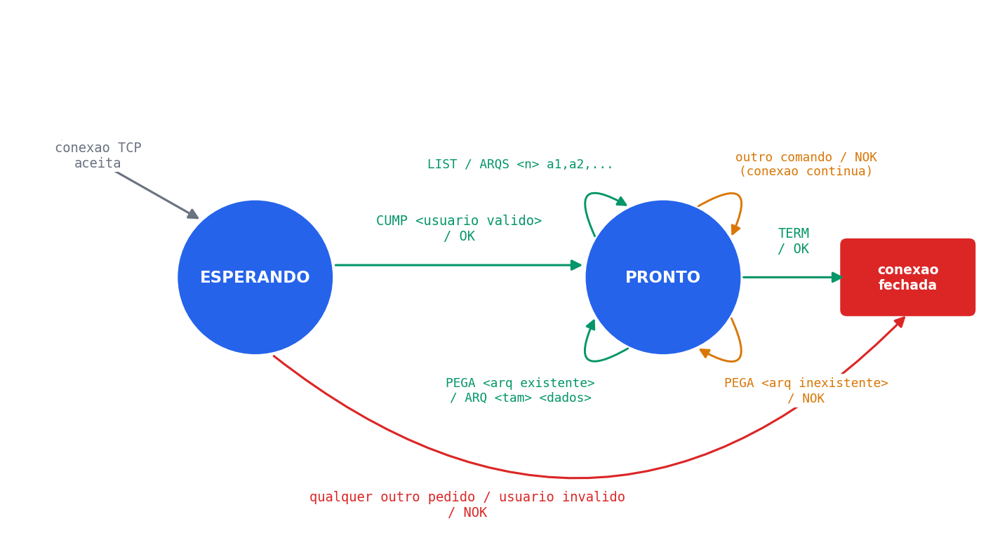
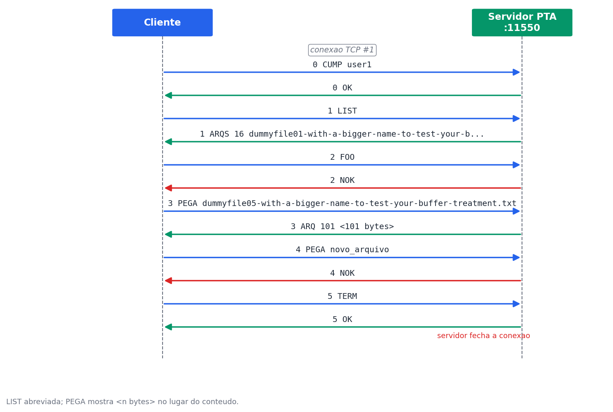
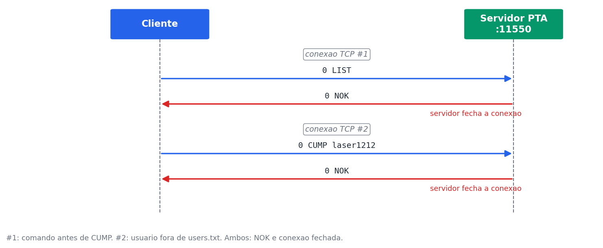
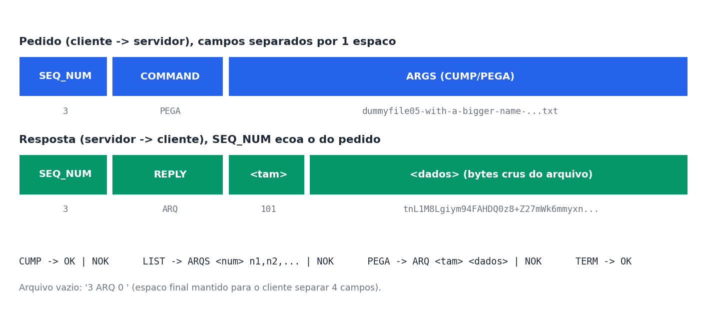

## Cloud Computer

| | |
|---|---|
| Discente | Ivan Igor Antunes Neves |
| Matrícula | 202600470016 |
| Disciplina | Computação em Nuvem |
| Docente | Prof. Glauco Gonçalves |
| Programa | Programa de Pós-Graduação em Engenharia Elétrica (PPGEE) |
| Instituição | Universidade Federal do Pará (UFPA) |

# Practical Exam
Please fork this repo and develop your server based on the protocol described in [pta.pdf][ptad] file (in portuguese). Before coding, I suggest you carefully read the document spec and understand the protocol. Experiment the protocol, using paper and pencil, drawing examples of protocol usage.

Please develop your server code in the directory [pta-server][ptas]. The user list that must be accepted by the protocol must be read from the [pta-server/users.txt][ptau] file. The files to be served by your server are in the [pta-server/files][ptaa] directory. Please don't change these files and directories.

Your server code will be evaluated through an automatic testing tool. This way, in order to test your code you can use the [pta-client.py][ptac] file. This file makes some tests but it is not an extensive test. So, keep in mind that the actual evaluation will test other aspects of your protocol implementation.

You could use any programming language. But you must provide instructions in order to successfully run your code. Describe all stuff about libraries, interpreters, versions and so on. After finishing development, you must share the link of your github repo in the evaluation environment ([sigaa.ufpa.br](http://sigaa.ufpa.br/)).

[ptas]: <https://github.com/glaucogoncalves/pta/tree/master/pta-server>
[ptau]: <https://github.com/glaucogoncalves/pta/tree/master/pta-server/users.txt>
[ptaa]: <https://github.com/glaucogoncalves/pta/tree/master/pta-server/files>
[ptac]: <https://github.com/glaucogoncalves/pta/tree/master/pta-client.py>
[ptad]: <https://github.com/glaucogoncalves/pta/tree/master/pta.pdf>

## Solucao

Servidor implementado em Python 3 (somente biblioteca padrao): [pta-server/pta_server.py](pta-server/pta_server.py). Instrucoes de execucao e detalhes em [pta-server/README.md](pta-server/README.md).

Em um terminal, iniciar o servidor (porta 11550):

```bash
python pta-server/pta_server.py
```

Em outro terminal, executar o cliente de teste:

```bash
python pta-client.py 127.0.0.1 11550 user1
```

### Fluxo do protocolo

Arquitetura: uma thread por conexao, cada uma com sua propria maquina de estados.



Maquina de estados de cada sessao.



Sessao completa, com mensagens reais capturadas do servidor.



Rejeicoes no estado ESPERANDO.



Formato das mensagens.


